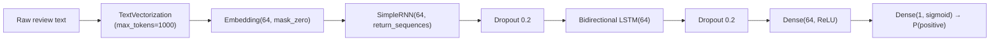

# IMDB Sentiment Analysis with RNN-LSTM

A binary sentiment classifier (positive / negative) for IMDB movie reviews, built with TensorFlow/Keras: a `TextVectorization` encoder, an embedding layer, a SimpleRNN layer and a bidirectional LSTM. It comes with a Streamlit app for single-review and batch (CSV/TXT) prediction.

## Problem Statement

Given the free text of a movie review, predict whether the reviewer's sentiment is positive or negative. This is the classic IMDB 50K benchmark, used here to practise end-to-end NLP with recurrent networks.

## Features

- Text cleaning (removes @mentions, URLs and non-alphanumeric characters; lower-cases).
- Self-contained Keras model. The `TextVectorization` layer is inside the saved model, so raw strings can be passed directly.
- Streamlit app (`app.py`) with three tabs:
  1. **Single Review Analysis**: sentiment label, confidence and a gauge chart.
  2. **Batch Analysis**: upload a CSV (first column = review) or TXT (one review per line), view results and download them as CSV.
  3. **Model Evaluation**: ⚠️ shows **randomly generated placeholder metrics**, not the model's real performance (see [Limitations](#limitations)).

## Technologies

Python, TensorFlow/Keras 2.12 (the model's saved `keras_version`), Streamlit, pandas, NumPy, scikit-learn, Matplotlib, Seaborn.

## Model Architecture



Training configuration (from the notebook): Adam (lr = 1e-4), `BinaryCrossentropy(from_logits=True)`, `EPOCHS = 2`, EarlyStopping on `val_accuracy` (patience 3), ReduceLROnPlateau on `val_loss`. The first 40,000 reviews are used for training and the last 10,000 for testing.

## Results (as recorded in the notebook)

On the 10,000-review test split:

| Class | Precision | Recall | F1 | Support |
|---|---|---|---|---|
| 0 (negative) | 0.69 | 0.22 | 0.33 | 4,993 |
| 1 (positive) | 0.54 | 0.90 | 0.67 | 5,007 |
| **Accuracy** | | | **0.5607** | 10,000 |

This is only slightly better than chance. The model is under-trained: the notebook sets `EPOCHS = 2`, and its training log stops partway through the first epoch. Despite its name, `sentiment_RNN_10epochs.model` was not trained for 10 epochs in the recorded run.

## Project Structure

```
.
├── IMDB - Sentiment Analysis Using RNN-LSTM.ipynb   # EDA, preprocessing, model, training, evaluation
├── app.py                                           # Streamlit app (loads sentiment_RNN_10epochs.model)
├── sentiment_RNN_10epochs.model/                    # TF SavedModel used by the app (~8 MB)
├── sentiment_model/                                 # TF SavedModel saved earlier in the notebook (~8 MB)
├── requirements.txt
└── .gitignore
```

## Installation

TensorFlow 2.12–2.15 needs **Python 3.9–3.11**.

```bash
python -m venv venv
venv\Scripts\activate            # Windows  (source venv/bin/activate on Linux/macOS)
pip install -r requirements.txt
```

## Configuration

No environment variables or secrets are used.

## Usage

```bash
streamlit run app.py
```

Run it from the repository root, because the model is loaded from the relative path `sentiment_RNN_10epochs.model`.

To re-run the notebook, download the dataset (see below) and update the `pd.read_csv(...)` path in cell 7, which currently points to a local Windows path.

## Dataset

The **IMDB Dataset of 50K Movie Reviews** (columns `review`, `sentiment`). It is not committed (about 63 MB). Download `IMDB Dataset.csv` from Kaggle (*"IMDB Dataset of 50K Movie Reviews"*) and place it in the project folder. The notebook writes these derived files, which are also git-ignored:

- `movie_reviews_train.csv` (first 40,000 rows)
- `movie_reviews_test.csv` (last 10,000 rows)
- `Test_Predictioin.csv` (test rows with predictions)

## Limitations

- **Low accuracy (0.56)**. See Results.
- **The "Model Evaluation" tab is a demo.** It builds a confusion matrix, classification report and accuracy from `np.random.randint` values, not from the model. Ignore those numbers.
- The model ends in `sigmoid` but is compiled with `from_logits=True`, which is inconsistent and may hurt training.
- `TextVectorization` vocabulary is limited to 1,000 tokens.
- Requires TensorFlow < 2.16. Keras 3 cannot load these SavedModel directories with `load_model`.

## Future Improvements

- Fix the loss configuration and train for more epochs. Compare with a larger vocabulary and pretrained embeddings or a transformer.
- Replace the placeholder evaluation tab with real metrics computed on the held-out test set.
- Re-export the model in `.keras` format for Keras 3 compatibility.

## Author

**Mosap Abdel-Ghany**: [github.com/Mosapmohamd](https://github.com/Mosapmohamd)
